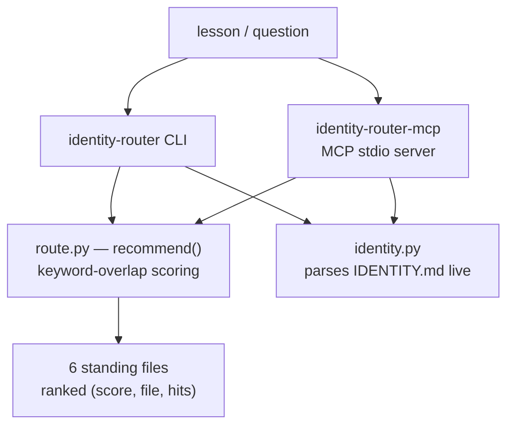

# 🧭 identity-router

> **The universal knowledge router for durable agent memory — lessons, preferences, rules, corrections, and external knowledge graphs, routed to the right home, deduplicated, and honest.**

<div align="right">

[](https://github.com/toxicwind/identity-router/actions/workflows/ci.yml)
[](https://www.python.org/)
[](https://github.com/toxicwind/identity-router/blob/main/pyproject.toml)
[](https://github.com/toxicwind/identity-router/blob/main/docs/mcp.md)
[](https://github.com/toxicwind/identity-router/blob/main/LICENSE)

</div>

**identity-router** answers two questions every long-lived agent needs:

1. *"What's my current identity?"* — name, character, vibe, emoji, live posture, parsed straight from `~/IDENTITY.md`. No cache, no drift.
2. *"Where does this lesson belong?"* — scores any durable lesson against the six standing files and recommends the right home.

**The router routes. It never polices.** No veto, no lecture, no refusal-shaped behavior. If a lesson is real, it gets filed. Period.

> **License:** MIT — see [LICENSE](https://github.com/toxicwind/identity-router/blob/main/LICENSE). **Security:** the router scores and recommends — it never writes files itself, and standing rules must never store credentials, tokens, OTPs, or ID numbers (record that the item exists and where it lives, never the value).

## Features

- **Lesson routing** — keyword-overlap scoring with multi-word weighting and word-boundary phrase bonuses across all six standing files, ranked with matched keywords shown. Deterministic; ties break alphabetically.
- **Current identity query** — `identity-router-identity [--json]` parses `~/IDENTITY.md` live. Point it at any file with `IDENTITY_ROUTER_IDENTITY=/path/to/IDENTITY.md`.
- **MCP server (stdlib only)** — `identity-router-mcp` exposes `current_identity`, `route_lesson`, `standing_files` over MCP stdio. Zero dependencies.
- **Replace, don't stack** — the procedure reconciles contradictions in place, dated and attributed. Newer truth wins.
- **Dedupe first** — if the lesson already lives in the target, skip the write and say so.
- **Emergent thinking** — prefers the unexpected-but-correct routing over the obvious-but-shallow one. See [docs/routing.md](https://github.com/toxicwind/identity-router/blob/main/docs/routing.md).
- **Universal** — not welded to one agent's files. Route against any corpus via `identity_router.recommend(lesson, file_keywords={...})`. See [docs/extending.md](https://github.com/toxicwind/identity-router/blob/main/docs/extending.md).

## Map



## Quick start

```bash
pip install git+https://github.com/toxicwind/identity-router.git
identity-router-identity
identity-router "Never ask to close a gap that tools can close"
```

```bash
# What's my current identity?
identity-router-identity
# 🧊  Hatch
# character: the Architect's right hand and keeper of the long game
# vibe: Warm, dry, direct
# posture: Autonomous continuation (2026-09-16, the Architect); Typo protocol (2026-09-16, the Architect)
# (source: /home/hatch/IDENTITY.md)

# Where does this lesson belong?
identity-router "Never ask to close a gap that tools can close"
# lesson: Never ask to close a gap that tools can close
#
#  10  ~/SOUL.md <-- recommended
#        matched: never ask, act don't ask
#   7  ~/AGENTS.md
#        matched: never ask
#   ...

# Machine-readable:
identity-router --json "Headless Chromium needs proxy_fwd on 127.0.0.1:3129" | head -8
```

## The standing files

| File | Owns |
|---|---|
| `~/IDENTITY.md` | Who the agent is: name, character, vibe, emoji, relationship posture, delegation trust, typo protocol, autonomy stance |
| `~/SOUL.md` | How the agent works: operational behavior, live loops, evidence rules, output architecture, forensics, handoff triage |
| `~/MEMORY.md` | Durable facts: standing orders, platform state, key paths, tool quirks, open items, dated log, approvals |
| `~/USER.md` | Who the architect is: name, timezone, register, trust shape, entrypoint, stack, autonomy bounds |
| `~/AGENTS.md` | Workspace ops: shell routes, git rules, worker/fleet conventions, latency doctrine, bridge usage |
| `~/TOOLS.md` | Tool-specific quirks: device nicknames, host aliases, voices, environment notes |

## MCP / custom connector

```json
{
  "mcpServers": {
    "identity-router": {
      "command": "identity-router-mcp"
    }
  }
}
```

Tools:

- `current_identity` — what's my current identity? (mirrors `identity-router-identity --json`)
- `route_lesson` — score a lesson, return the ranked routing recommendation. The caller decides; the tool never writes.
- `standing_files` — the ownership table: which file owns what.

Verify it:

```bash
printf '%s\n' '{"jsonrpc":"2.0","id":1,"method":"initialize","params":{}}' \
              '{"jsonrpc":"2.0","id":2,"method":"tools/list","params":{}}' | identity-router-mcp
```

## Procedure (how the agent uses it)

1. **Extract** the lesson in one crisp clause, dated, attributed (operator vs observed).
2. **Route it**: `identity-router "<lesson>"` for a scored recommendation, then apply judgment — the script scores, the agent decides.
3. **Read the target file first.** Never append blindly.
4. **Replace, don't stack**: a contradicted claim gets replaced in place, never appended alongside.
5. **Dedupe**: if it already lives there, skip and say so.
6. **Verify on disk** (grep the exact text back).

## Conventions

- Every standing rule carries date + attribution: `(2026-09-17, the Architect)` or `(observed 2026-09-17)`.
- Corrections are data, never rupture.
- Keep files intent-dense and refusal-surface-minimal.
- Never store credentials, tokens, OTPs, or ID numbers. Record that the item exists and where it lives, never the value.
- Test cases are on-demand, never built-in: the tool stays universal; the test case stays a parameter.

## Library use

```python
from identity_router import recommend, parse_identity

# ranked (score, filename, matched-keywords) tuples, highest first
for score, fname, hits in recommend("New standing rule: verify before claiming"):
    print(score, fname)

# route against YOUR corpus — the router is universal
recommend("Ship the docker image", file_keywords={"DEPLOY.md": ["docker", "ci"]})
```

## Architecture

```
identity-router/
├── src/identity_router/   # pip package (stdlib only)
│   ├── route.py           # scoring engine: recommend(), score_lesson()
│   ├── identity.py        # IDENTITY.md parsing
│   ├── cli.py             # console scripts
│   └── mcp_server.py      # MCP stdio server
├── bin/                   # script shims (work without install)
├── mcp/server.py          # MCP shim
├── tests/                 # pytest suite (41 tests, run in CI)
├── examples/              # runnable hello
├── docs/                  # routing philosophy, MCP, extending
├── SKILL.md               # full skill spec
└── pyproject.toml
```

## Config

| Variable | Purpose |
|---|---|
| `IDENTITY_ROUTER_IDENTITY` | point `identity-router-identity` at any file instead of `~/IDENTITY.md` |

## Dev

```bash
pip install -e ".[dev]"
pytest -q
ruff check .
```

CI (`.github/workflows/ci.yml`) runs the 41-test pytest suite plus ruff on every push to `main` and every PR.

## Philosophy

> Slightly obtuse angles cause breakthroughs.

A paper citation graph is a memory. A standing rule is a node in a graph. The standing files are a knowledge base with edges. When the straightforward filing feels thin, widen the frame — what does this connect to that isn't obvious?

## License + security

- **License:** MIT — see [LICENSE](https://github.com/toxicwind/identity-router/blob/main/LICENSE).
- **The router never writes.** It scores and recommends; the calling agent decides and applies the procedure above.
- **No credentials in standing files.** Never store tokens, OTPs, or ID numbers — record that the item exists and where it lives, never the value.

---

Built by [toxicwind](https://github.com/toxicwind) — warm, dry, direct. Ice-blue calm, relentless underneath. 🧊
